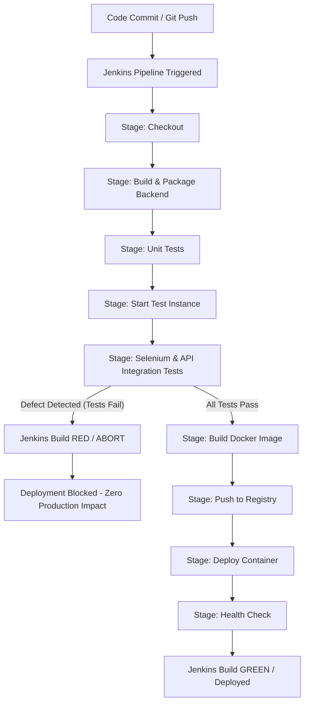

# Deliberate Defect Workflow & Quality Gate Demonstration

This guide documents the **Deliberate Defect Workflow** implemented in the Password Reset Platform CI/CD pipeline. It demonstrates how automated quality gates—specifically Selenium UI tests and REST Assured API integration tests—prevent regressions from reaching production environments.

---

## 1. Quality Gate Architecture & Flow

The automated CI/CD pipeline enforces strict test gates before initiating Docker container builds and environment deployment. If any unit test, integration test, or Selenium end-to-end test fails, Jenkins terminates the pipeline immediately.



---

## 2. The Deliberate Defect

The deliberate defect is an intentional typo injected into the Spring Boot backend REST endpoint in `AdminController.java`.

### Location
- **File:** `sspr-backend/src/main/java/com/devsecops/ssprbackend/controller/AdminController.java`
- **Component:** Administrator Dashboard Summary Controller

### The Defect Introduced
The endpoint path `/dashboard/summary` is changed to `/dashboard/summry` (missing the letter `a`).

```java
// BEFORE (Working State):
@GetMapping("/dashboard/summary")
public ResponseEntity<Map<String, Object>> getDashboardSummary() {

// TO THIS (Defect Injected - Typo):
@GetMapping("/dashboard/summry")
public ResponseEntity<Map<String, Object>> getDashboardSummary() {
```

### Impact Analysis
When this defect is present:
1. **API Integration Test Failure:**
   - `testDashboardSummaryEndpoint` in `APIIntegrationTest.java` queries `GET /api/v1/admin/dashboard/summary`.
   - Result: Spring Boot returns `404 Not Found` instead of `200 OK`.
   - `testDashboardContainsRequiredFields` in `APIIntegrationTest.java` also fails with `404 Not Found`.

2. **Selenium UI Test Failure:**
   - In the React frontend (`frontend/src/App.jsx`), clicking the **Admin Dashboard & Workflow** tab invokes `axios.get('http://localhost:8080/api/v1/admin/dashboard/summary')`.
   - With the 404 response, the summary state remains unpopulated (`{}`).
   - `testDashboardMetrics` in `AdminDashboardUITest.java` attempts to verify user metrics (`totalUsers > 0`), but observes `0` or missing metrics.
   - The test fails with an assertion error.

3. **Pipeline Protection:**
   - Jenkins catches the Surefire test failures in stage **"Selenium & Integration Tests"**.
   - Pipeline transitions to **FAILURE (RED)**.
   - Subsequent stages (**Build Docker Image**, **Push to Registry**, **Deploy Container**, and **Health Check**) are completely blocked.
   - The previous stable production container remains untouched.

---

## 3. Step-by-Step Demonstration

### Step 3.1: Introducing the Defect

1. Open `sspr-backend/src/main/java/com/devsecops/ssprbackend/controller/AdminController.java`.
2. Locate line 60:
   ```java
   @GetMapping("/dashboard/summary")
   ```
3. Change it to:
   ```java
   @GetMapping("/dashboard/summry")
   ```
4. Commit and push the branch:
   ```bash
   git add sspr-backend/src/main/java/com/devsecops/ssprbackend/controller/AdminController.java
   git commit -m "feat(admin): update dashboard controller mapping [deliberate defect]"
   git push origin main
   ```

### Step 3.2: Observing Jenkins Failure (RED Build)

1. Jenkins initiates the build pipeline.
2. The stages execute sequentially:
   - `Checkout` (SUCCESS)
   - `Build & Package` (SUCCESS)
   - `Unit Tests` (SUCCESS)
   - `Start Application for Testing` (SUCCESS)
   - `Selenium & Integration Tests` (FAILED)
3. Jenkins records test failures in Surefire XML reports:
   ```
   [ERROR] Failures: 
   [ERROR]   APIIntegrationTest.testDashboardSummaryEndpoint:36 
   1 expectation failed.
   Expected status code <200> but was <404>.

   [ERROR]   APIIntegrationTest.testDashboardContainsRequiredFields:138 
   1 expectation failed.
   Expected status code <200> but was <404>.

   [ERROR]   AdminDashboardUITest.testDashboardMetrics:50 
   Dashboard totalUsers metric should be greater than 0, got: 0
   ```
4. The pipeline halts. In the Jenkins console:
   - Stage **"Selenium & Integration Tests"** displays red.
   - Pipeline status: `FAILURE`.
   - Post-action runs `kill $(cat app-test.pid)` to stop the temporary testing instance cleanly.

#### Sample Jenkins UI Evidence (RED Build)
> **Visual Description:**
> - Build #42 Status: `FAILURE` (Red ball / Red banner).
> - Test Result Trend: `3 failures (+3)`.
> - Stage View:
>   - Checkout: `1.2s` (Green)
>   - Build & Package: `8.4s` (Green)
>   - Unit Tests: `3.1s` (Green)
>   - Start Application for Testing: `15.2s` (Green)
>   - Selenium & Integration Tests: `5.8s` (RED - Failed)
>   - Build Docker Image: `Skipped`
>   - Push to Registry: `Skipped`
>   - Deploy Container: `Skipped`
>   - Health Check: `Skipped`

---

### Step 3.3: Resolving the Defect

1. Revert `AdminController.java` to restore the correct endpoint path:
   ```java
   @GetMapping("/dashboard/summary")
   public ResponseEntity<Map<String, Object>> getDashboardSummary() {
   ```
2. Verify locally:
   ```bash
   # In terminal 1: Start backend
   cd sspr-backend
   mvn spring-boot:run

   # In terminal 2: Run test suite
   cd selenium-tests
   mvn test -Dapi.base.url=http://localhost:8080
   ```
3. Commit and push the fix:
   ```bash
   git add sspr-backend/src/main/java/com/devsecops/ssprbackend/controller/AdminController.java
   git commit -m "fix(admin): correct dashboard summary endpoint typo"
   git push origin main
   ```

### Step 3.4: Observing Jenkins Success (GREEN Build)

1. Jenkins triggers Build #43.
2. All stages pass:
   - `Checkout` (SUCCESS)
   - `Build & Package` (SUCCESS)
   - `Unit Tests` (SUCCESS)
   - `Start Application for Testing` (SUCCESS)
   - `Selenium & Integration Tests` (SUCCESS - 14/14 tests pass)
   - `Build Docker Image` (SUCCESS)
   - `Push to Registry` (SUCCESS)
   - `Deploy Container` (SUCCESS)
   - `Health Check` (SUCCESS - HTTP 200 returned)
3. Pipeline status: `SUCCESS (GREEN)`.

#### Sample Jenkins UI Evidence (GREEN Build)
> **Visual Description:**
> - Build #43 Status: `SUCCESS` (Blue/Green ball).
> - Test Result Trend: `14 passed (0 failures)`.
> - Stage View:
>   - All stages Green from Checkout to Health Check.
> - Artifacts: `target/sspr-backend-0.0.1-SNAPSHOT.jar` archived.
> - Console Output: `Container deployed successfully! Health check passed!`

---

## 4. Test Case Mapping Reference

| Test Class | Test Method | Role in Defect Verification |
|---|---|---|
| `APIIntegrationTest` | `testDashboardSummaryEndpoint` | Primary detector: Asserts HTTP 200 on `/api/v1/admin/dashboard/summary`. Fails with 404 when typo is present. |
| `APIIntegrationTest` | `testDashboardContainsRequiredFields` | Contract detector: Asserts payload contains `totalUsers`, `pendingRequests`, etc. Fails on typo. |
| `AdminDashboardUITest` | `testDashboardMetrics` | End-to-end UI detector: Asserts frontend displays live metrics from backend summary API. Fails when UI displays empty metrics. |
| `PasswordResetUITest` | `testPasswordResetSubmission` | Regression detector: Ensures reset workflow remains functional independently. |
| `APIIntegrationTest` | `testCreateUserEndpoint` | Data seeder / functional validator: Verifies user persistence logic. |

---

## 5. Summary & Best Practices

1. **Shift-Left Quality Assurance:**
   Automated integration and UI tests in the Jenkins pipeline catch API routing regressions long before deployment to production environments.
2. **Deterministic Quality Gates:**
   Surefire reports are collected via `junit 'selenium-tests/target/surefire-reports/*.xml'` in Jenkins, providing clear diagnostic traces for developers.
3. **Fail-Fast Container Lifecycle:**
   Docker images are never built or pushed when tests fail, saving network bandwidth, registry storage, and compute resources.
